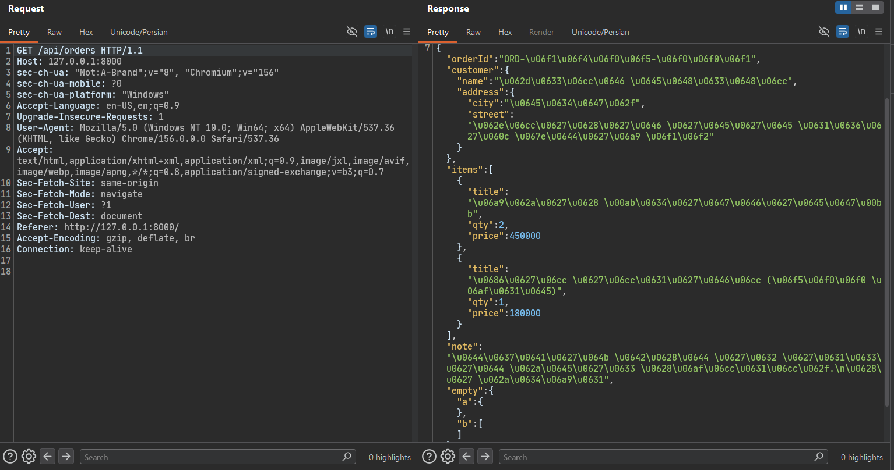
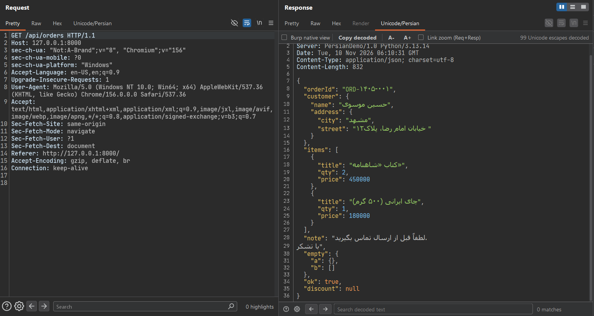
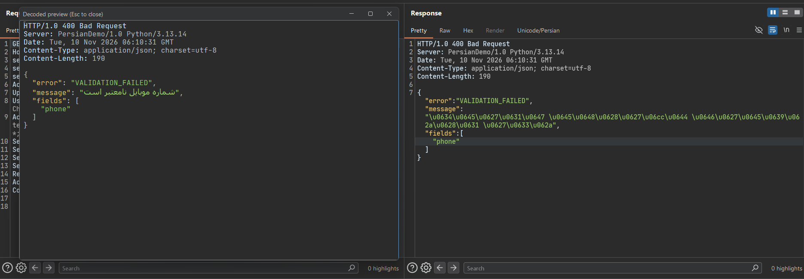
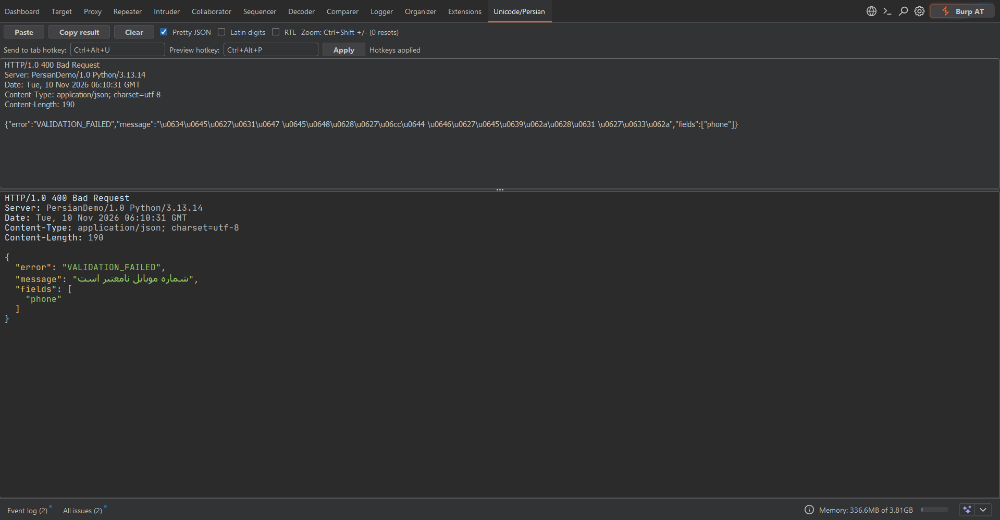

<div dir="rtl">

# Unicode and Persian Viewer

[English](README.md) | [فارسی](README.fa.md)

یک اکستنشن برای [Burp Suite](https://portswigger.net/burp) که با Montoya API نوشته شده و escapeهای `\uXXXX` رو دیکود می‌کنه و متن فارسی/عربی رو داخل Burp درست نمایش می‌ده. این اکستنشن یک تب **Unicode/Persian** به ادیتورهای Request و Response اضافه می‌کنه، به‌علاوه یک تب مستقل در Burp، یک گزینه در منوی راست‌کلیک و یک پنجره پیش‌نمایش.

این اکستنشن فقط **نحوه نمایش** پیام رو عوض می‌کنه و هیچ‌وقت ترافیک رو تغییر نمی‌ده.


## اسکرین‌شات‌ها

**قبل:** ویوی داخلی Burp متن فارسی رو به‌صورت escapeهای `\uXXXX` نشون می‌ده.



**بعد:** تب **Unicode/Persian** در ادیتور Request / Response متن رو دیکود می‌کنه، JSON رو مرتب می‌کنه و با فونت فارسی نشون می‌ده.



**پنجره پیش‌نمایش:** متن رو انتخاب کن (یا کل پیام) و `Ctrl+Alt+P` رو بزن یا از منوی راست‌کلیک استفاده کن.



**تب مستقل:** هر متنی رو paste کن و دیکودشده‌اش رو زنده ببین. تنظیم میانبرها هم اینجاست.



## چرا؟

خیلی از APIها JSON رو این‌شکلی برمی‌گردونن:

</div>

```json
{"name":"\u0639\u0644\u06cc \u0631\u0636\u0627\u06cc\u06cc","city":"\u062a\u0647\u0631\u0627\u0646"}
```

<div dir="rtl">

ویوهای خود Burp این escapeها رو همون‌طور که هستن نشون می‌دن. حتی وقتی فارسی نمایش داده می‌شه، ترکیب متن راست‌به‌چپ و چپ‌به‌راست، ارقام و علائم نگارشی معمولاً به‌هم می‌ریزه. این اکستنشن متن رو دیکود می‌کنه، JSON رو مرتب می‌کنه و با فونت فارسی مناسب نشون می‌ده:

</div>

```json
{
  "name": "علی رضایی",
  "city": "تهران"
}
```

<div dir="rtl">

## قابلیت‌ها

- **تب «Unicode/Persian»** در ادیتورهای Request و Response (در Proxy، Repeater، Logger و ابزارهای دیگه).
  - تب Request همیشه نمایش داده می‌شه.
  - تب Response فقط وقتی نمایش داده می‌شه که پاسخ شامل escapeهای `\uXXXX` یا متن عربی/فارسی با کدگذاری UTF-8 باشه.
  - تب فقط‌خواندنیه (پیام رو «تغییریافته» علامت نمی‌زنه).
- **دیکود:** `\uXXXX`، `\n`، `\t`، `\/` (و `\r` حذف می‌شه).
- **Pretty JSON:** بدنه‌هایی که با `{` یا `[` شروع بشن مرتب و تورفته نمایش داده می‌شن.
- **Latin digits:** اختیاری، ارقام فارسی (`۰-۹`) و عربی (`٠-٩`) رو به `0-9` تبدیل می‌کنه.
- **گزینه RTL** برای چیدمان راست‌به‌چپ.
- **فونت مخصوص فارسی:** بخش‌های فارسی/عربی با فونت فارسی و بقیه با فونت monospace نمایش داده می‌شن (بخش [فونت‌ها](#فونتها)).
- **رنگ‌بندی سینتکس** برای هدرهای HTTP، JSON، بدنه `x-www-form-urlencoded`، HTML (تگ‌ها و attributeها) و JavaScript داخل صفحه.
- **نوار جستجو** داخل تب: `Ctrl+F` برای فوکوس، `Enter` برای مورد بعدی، حالت‌های اختیاری Case sensitive و Regex، اسکرول خودکار به نتیجه، تا ۵۰۰۰ مورد.
- **زوم:** `Ctrl+Shift` و `+` / `-` (با `0` ریست می‌شه)، `Ctrl` + چرخ ماوس یا دکمه‌های `A-` / `A+`. زوم Request و Response می‌تونه به‌هم لینک باشه یا جدا.
- **Burp native view:** یک چک‌باکس که متن دیکودشده رو داخل ادیتور خود Burp نشون می‌ده تا هایلایت و جستجوی خود Burp رو داشته باشی. نمایش bidi فارسی اونجا ضعیف‌تره.
- دکمه **Copy decoded** و شمارنده‌ای که نشون می‌ده چند Unicode escape دیکود شده.
- **تب مستقل «Unicode/Persian»:** هر متنی رو paste کن و دیکودشده‌اش رو زنده ببین.
- **منوی راست‌کلیک** روی هر پیام: *Send to Unicode/Persian tab* و *Preview decoded*.
- **میانبرها** (قابل تنظیم و ذخیره در تنظیمات Burp):

  | عملیات | پیش‌فرض |
  |---|---|
  | ارسال بخش انتخاب‌شده به تب Unicode/Persian | `Ctrl+Alt+U` |
  | باز کردن پنجره پیش‌نمایش | `Ctrl+Alt+P` |

  اگه بخشی از پیام انتخاب شده باشه فقط همون استفاده می‌شه، وگرنه کل پیام.
- **پنجره پیش‌نمایش:** پنجره جدا و قابل تغییر اندازه که با `Esc` بسته می‌شه.
- **تم روشن / تیره:** با تم Burp هماهنگه و با عوض‌کردنش خودش رو دوباره استایل می‌کنه.
- **تنظیمات ماندگار:** زوم، میانبرها و گزینه‌های جستجو به خاطر سپرده می‌شن.

## پیش‌نیازها

- Burp Suite (Community یا Professional) با پشتیبانی از Montoya API.
- JDK نسخه ۱۷ یا بالاتر برای بیلد.
- Python 3.8 یا بالاتر، فقط اگه بخوای از تولیدکننده ترافیک دمو استفاده کنی.

## بیلد

۱. فایل jar مربوط به Montoya API رو از Maven Central بگیر (`net.portswigger.burp.extensions:montoya-api`) و با اسم `montoya-api.jar` کنار سورس بذار. از نسخه جدید استفاده کن، چون اکستنشن از APIهای hotkey و message editor استفاده می‌کنه.

۲. کامپایل و بسته‌بندی:

</div>

```bash
javac --release 17 -encoding UTF-8 -cp montoya-api.jar -d out src/DecoderExtension.java
jar cf viewer.jar -C out .
```

<div dir="rtl">

گزینه `-encoding UTF-8` مهمه، چون ممکنه سورس کاراکتر غیر ASCII داشته باشه.

> روی ویندوز اگه `javac` گفت پوشه `out` وجود نداره، اول پوشه رو بساز.

## نصب در Burp

۱. برو به **Extensions → Installed → Add**.

۲. *Extension type* رو روی **Java** بذار.

۳. فایل `viewer.jar` رو انتخاب کن و **Next** رو بزن.

۴. بعد از لود شدن، تب **Unicode/Persian** تو Burp و تب **Unicode/Persian** داخل ادیتورهای پیام ظاهر می‌شه.

## نحوه استفاده

- **داخل ادیتور:** هر درخواست یا پاسخی رو باز کن و روی تب **Unicode/Persian** کلیک کن.
- **از روی انتخاب:** تو ادیتور مقداری متن انتخاب کن و `Ctrl+Alt+U` (ارسال به تب مستقل) یا `Ctrl+Alt+P` (پنجره پیش‌نمایش) رو بزن، یا از منوی راست‌کلیک استفاده کن.
- **مستقل:** تب مستقل رو باز کن و متن رو paste کن، یا دکمه **Paste** رو بزن.
- **میانبرها:** دو فیلد بالای تب مستقل رو ویرایش کن و **Apply** بزن. از فرمت خود Burp استفاده کن، مثلاً `Ctrl+Alt+U`. خالی گذاشتن یک فیلد اون میانبر رو غیرفعال می‌کنه. اگه کلیدی با میانبر Burp تداخل داشته باشه، برچسب وضعیت خطا نشون می‌ده.

## ترافیک دمو

فایل `demo/demo_server.py` یک هدف کوچیکه که JSON فارسی رو با escapeهای `\uXXXX` برمی‌گردونه تا بتونی همون لحظه اکستنشن رو امتحان کنی. فقط از کتابخونه استاندارد پایتون استفاده می‌کنه.

</div>

```bash
# 1. سرور دمو رو روی 127.0.0.1:8000 بالا بیار
python demo/demo_server.py serve

# 2. تو Burp مطمئن شو پروکسی روی 127.0.0.1:8080 گوش می‌ده

# 3. درخواست‌های نمونه رو از مسیر Burp بفرست
python demo/demo_server.py client
```

<div dir="rtl">

می‌تونی مرورگر رو هم روی پروکسی Burp بذاری و `http://127.0.0.1:8000/` رو باز کنی، یا از curl استفاده کنی:

</div>

```bash
curl -x http://127.0.0.1:8080 http://127.0.0.1:8000/api/users
```

<div dir="rtl">

| اندپوینت | چی رو تست می‌کنه |
|---|---|
| `GET /api/users` | JSON مینیفای‌شده، اسم فارسی، ارقام فارسی، نیم‌فاصله (ZWNJ)، متن ترکیبی فارسی/انگلیسی |
| `GET /api/orders` | JSON تودرتو، `\n` داخل رشته، `{}` و `[]` خالی، `null` و `true` |
| `GET /api/error` | پاسخ ۴۰۰ با پیام خطای فارسی |
| `GET /api/big` | پاسخ حجیم، برای دیدن محدودیت‌های اندازه |
| `POST /api/echo` | بدنه درخواست با escapeهای `\uXXXX`، برای تب Request |

بعد برو **Proxy → HTTP history**، یک درخواست رو انتخاب کن و روی تب **Unicode/Persian** کلیک کن.

## فونت‌ها

برای بهترین نتیجه یک فونت فارسی نصب کن. اکستنشن اولین موردی که پیدا کنه رو استفاده می‌کنه:

- متن فارسی: `Vazirmatn`، `Vazir`، `Vazir Code`، `Sahel`، `Shabnam`، `Tahoma` و در نهایت `Dialog`.
- متن لاتین: `JetBrains Mono`، `JetBrainsMono NF`، `Consolas` و در نهایت `Monospaced`.

فونت [Vazirmatn](https://github.com/rastikerdar/vazirmatn) پیشنهاد می‌شه. بعد از نصب فونت، Burp رو ری‌استارت کن (یا اکستنشن رو دوباره لود کن).

## محدودیت‌ها

- ورودی در **۸۰۰٬۰۰۰ کاراکتر** بریده می‌شه و عبارت `[input truncated]` اضافه می‌شه.
- رنگ‌بندی سینتکس برای متن‌های بلندتر از **۱۵۰٬۰۰۰ کاراکتر** انجام نمی‌شه.
- جستجو در **۵۰۰۰ مورد** متوقف می‌شه.
- فرض بر اینه که متن UTF-8 هست.
- مقادیر `\uXXXX` کمتر از `U+0020` (کاراکترهای کنترلی) دست‌نخورده می‌مونن.

## عیب‌یابی

- **تب Unicode/Persian در ادیتور Response نیست:** این تب فقط وقتی نمایش داده می‌شه که پاسخ شامل escapeهای `\u` یا بایت‌های UTF-8 عربی/فارسی باشه. تب Request همیشه هست.
- **با میانبر یا منو هیچ اتفاقی نمی‌افته:** برو **Extensions → Installed → (این اکستنشن) → Output**. اکستنشن خطوطی با پیشوند `[viewer]` لاگ می‌کنه که نشون می‌ده چی گرفته.
- **حروف فارسی بریده‌بریده‌ان یا چیدمان عجیبه:** فونت Vazirmatn رو نصب کن و گزینه **RTL** رو جابه‌جا کن. برای متن‌های پر از bidi از *Burp native view* استفاده نکن.
- **میانبر خطا می‌ده:** ترکیب دیگه‌ای انتخاب کن. ممکنه Burp یا سیستم‌عامل از قبل ازش استفاده کرده باشن.
- **خطای بیلد درباره نبودن `burp.api.montoya`:** مطمئن شو `montoya-api.jar` تو مسیر `-cp` هست و نسخه‌اش جدیده.
