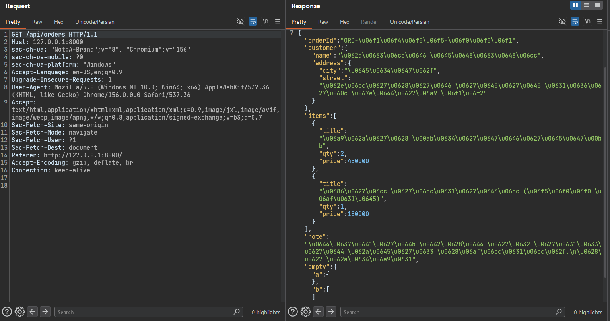
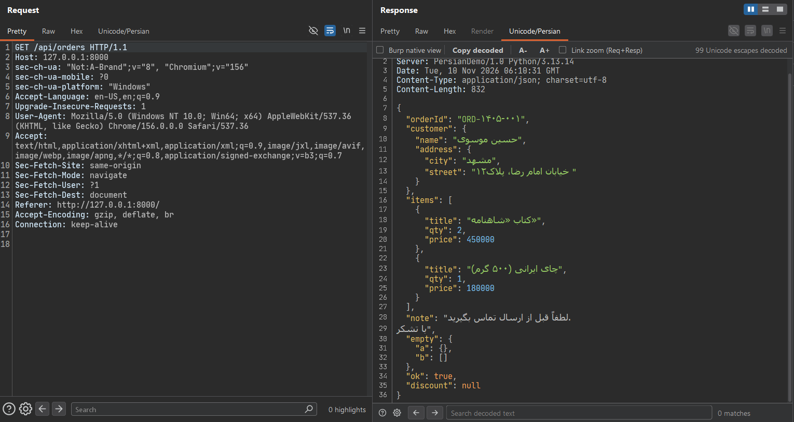
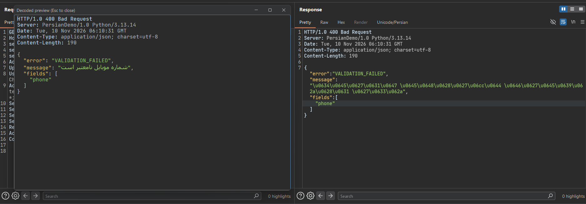
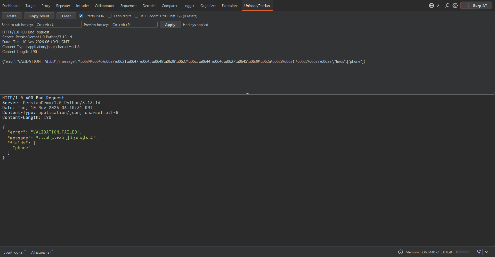

# Unicode and Persian Viewer

[English](README.md) | [فارسی](README.fa.md)

A [Burp Suite](https://portswigger.net/burp) extension, built on the Montoya API, that decodes `\uXXXX` escapes and renders Persian / Arabic text correctly inside Burp. It adds a **Unicode/Persian** tab to the Request and Response editors, a standalone suite tab, a context-menu action, and a pop-up preview window.

It only changes how a message is **displayed**. It never modifies traffic.


## Screenshots

**Before:** Burp's built-in view shows the Persian text as `\uXXXX` escapes.



**After:** the **Unicode/Persian** tab in the Request / Response editor decodes the text, pretty-prints the JSON and renders it with a Persian font.



**Preview window:** select text (or use the whole message) and press `Ctrl+Alt+P` or use the right-click menu.



**Suite tab:** paste any text and see it decoded live. Hotkeys are configured here.



## Why

APIs often return JSON like this:

```json
{"name":"\u0639\u0644\u06cc \u0631\u0636\u0627\u06cc\u06cc","city":"\u062a\u0647\u0631\u0627\u0646"}
```

Burp's own views show the escapes as-is, and even when Persian is displayed, mixed right-to-left and left-to-right text, digits and punctuation often look broken. This extension decodes the text, pretty-prints the JSON and renders it with a proper Persian font:

```json
{
  "name": "علی رضایی",
  "city": "تهران"
}
```

## Features

- **Editor tab "Unicode/Persian"** in the Request and Response message editors (Proxy, Repeater, Logger and other tools).
  - The Request tab is always available.
  - The Response tab appears only when the response contains `\uXXXX` escapes or UTF-8 encoded Arabic-script text.
  - The tab is read-only (it never marks a message as modified).
- **Decoding:** `\uXXXX`, `\n`, `\t`, `\/` (and `\r` is dropped).
- **Pretty JSON:** bodies starting with `{` or `[` are re-indented.
- **Latin digits:** optionally converts Persian (`۰-۹`) and Arabic-Indic (`٠-٩`) digits to `0-9`.
- **RTL switch** for right-to-left layout.
- **Persian-aware fonts:** Arabic-script runs use a Persian font, everything else uses a monospaced font (see [Fonts](#fonts)).
- **Syntax colors** for HTTP headers, JSON, `x-www-form-urlencoded` bodies, HTML (tags and attributes) and inline JavaScript.
- **Search bar** inside the tab: `Ctrl+F` to focus, `Enter` for the next match, optional case-sensitive and regex modes, optional auto-scroll to the match, up to 5000 matches.
- **Zoom:** `Ctrl+Shift` + `+` / `-` (`0` resets), `Ctrl` + mouse wheel, or the `A-` / `A+` buttons. Request and Response zoom can be linked or independent.
- **Burp native view:** a checkbox that shows the decoded text inside Burp's own editor, to get Burp's syntax highlighting and search bar. Persian bidi rendering is worse there.
- **Copy decoded** button and a counter of how many Unicode escapes were decoded.
- **Suite tab "Unicode/Persian":** paste any text and see it decoded live.
- **Context menu** on any message: *Send to Unicode/Persian tab* and *Preview decoded*.
- **Hotkeys** (configurable, saved in Burp preferences):

  | Action | Default |
  |---|---|
  | Send selection to the Unicode/Persian tab | `Ctrl+Alt+U` |
  | Open the decoded preview window | `Ctrl+Alt+P` |

  If part of the message is selected, only the selection is used. Otherwise the whole message is used.
- **Preview window:** a separate resizable window, closed with `Esc`.
- **Light / dark theme:** follows Burp's theme and restyles itself when you switch.
- **Persistent settings:** zoom, hotkeys and search options are remembered.

## Requirements

- Burp Suite (Community or Professional) with Montoya API support.
- JDK 17 or newer to build.
- Python 3.8+ only if you want to use the demo traffic generator.

## Build

1. Get the Montoya API jar from Maven Central (`net.portswigger.burp.extensions:montoya-api`) and put it next to the source as `montoya-api.jar`. Use a recent release, since the extension uses the hotkey and message-editor APIs.
2. Compile and package:

```bash
javac --release 17 -encoding UTF-8 -cp montoya-api.jar -d out src/DecoderExtension.java
jar cf viewer.jar -C out .
```

`-encoding UTF-8` matters: the source may contain non-ASCII characters.

> On Windows, create the `out` folder first if `javac` complains that it does not exist.

## Install in Burp

1. Open **Extensions → Installed → Add**.
2. Set *Extension type* to **Java**.
3. Select `viewer.jar` and click **Next**.
4. When it loads you will see the **Unicode/Persian** suite tab, and the **Unicode/Persian** tab in message editors.

## Usage

- **Inside an editor:** open any request or response and click the **Unicode/Persian** tab.
- **From a selection:** select some text in an editor, then press `Ctrl+Alt+U` (send to the suite tab) or `Ctrl+Alt+P` (preview window), or use the right-click menu.
- **Standalone:** open the suite tab and paste text, or use the **Paste** button.
- **Hotkeys:** edit the two fields at the top of the suite tab and click **Apply**. Use Burp's format, for example `Ctrl+Alt+U`. Leave a field empty to disable that hotkey. If a key conflicts with a Burp hotkey, the status label shows an error.

## Demo traffic

`demo/demo_server.py` is a tiny target that returns Persian JSON with `\uXXXX` escapes, so you can try the extension right away. It uses only the Python standard library.

```bash
# 1. Start the demo target on 127.0.0.1:8000
python demo/demo_server.py serve

# 2. In Burp, make sure the proxy listens on 127.0.0.1:8080

# 3. Send sample requests through Burp
python demo/demo_server.py client
```

You can also point a browser at the Burp proxy and open `http://127.0.0.1:8000/`, or use curl:

```bash
curl -x http://127.0.0.1:8080 http://127.0.0.1:8000/api/users
```

| Endpoint | What it exercises |
|---|---|
| `GET /api/users` | Minified JSON, Persian names, Persian digits, ZWNJ, mixed Persian/English |
| `GET /api/orders` | Nested JSON, `\n` inside strings, empty `{}` / `[]`, `null` / `true` |
| `GET /api/error` | A 400 response with a Persian error message |
| `GET /api/big` | A large response, to see the size limits |
| `POST /api/echo` | A request body with `\uXXXX` escapes, for the Request tab |

Then open **Proxy → HTTP history**, select a request and switch to the **Unicode/Persian** tab.

## Fonts

For the best result install a Persian font. The extension uses the first one it finds:

- Persian text: `Vazirmatn`, `Vazir`, `Vazir Code`, `Sahel`, `Shabnam`, `Tahoma`, then `Dialog`.
- Latin text: `JetBrains Mono`, `JetBrainsMono NF`, `Consolas`, then `Monospaced`.

[Vazirmatn](https://github.com/rastikerdar/vazirmatn) is recommended. Restart Burp (or reload the extension) after installing a font.

## Limits

- Input is cut at **800,000 characters** and marked with `[input truncated]`.
- Syntax coloring is skipped for text longer than **150,000 characters**.
- Search stops at **5000 matches**.
- Text is assumed to be UTF-8.
- `\uXXXX` values below `U+0020` (control characters) are left as they are.

## Troubleshooting

- **No Unicode/Persian tab in the Response editor:** the tab shows only when the response contains `\u` escapes or UTF-8 Arabic-script bytes. The Request tab is always shown.
- **Nothing happens on a hotkey or menu action:** open **Extensions → Installed → (this extension) → Output**. The extension logs lines starting with `[viewer]` that show what it captured.
- **Persian letters look disconnected or the layout is odd:** install Vazirmatn, and try toggling **RTL**. Avoid the *Burp native view* for bidi-heavy text.
- **The hotkey shows an error:** pick a different combination. It may already be used by Burp or by the system.
- **Build errors about missing `burp.api.montoya`:** check that `montoya-api.jar` is on the `-cp` path and is a recent version.
